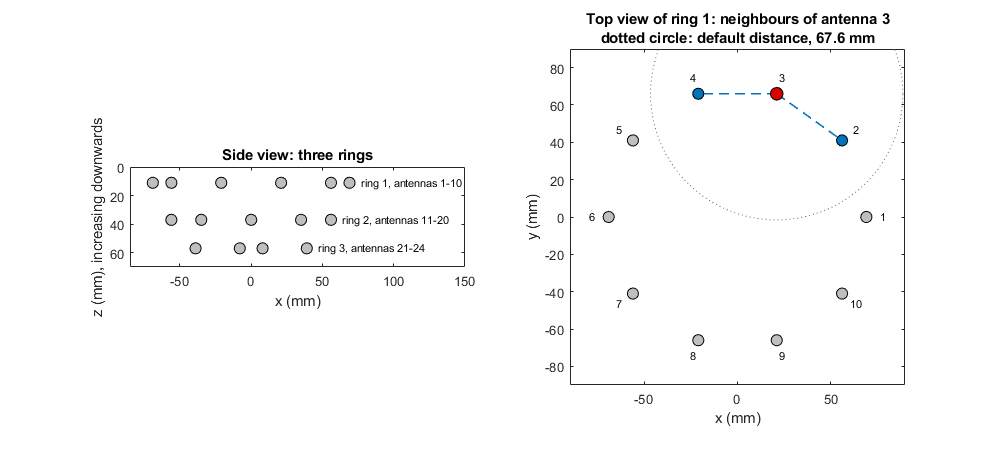
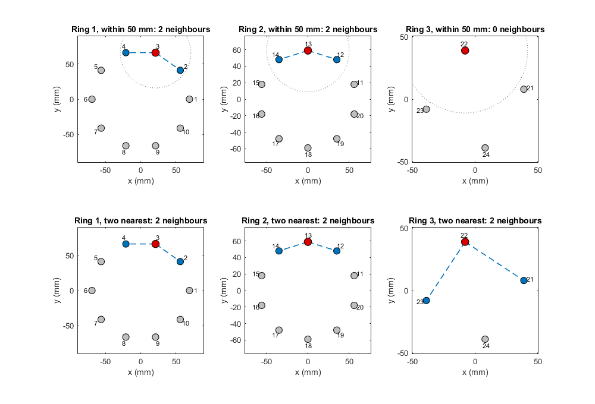

# antennaNeighbours

Neighbourhood of each antenna from the antenna positions

Package: `artefact`

## Syntax

```text
neighbours = artefact.antennaNeighbours(locations, channelPairs)
neighbours = artefact.antennaNeighbours(locations, channelPairs, Name, Value)
neighbours = artefact.antennaNeighbours(locations, channelPairs, method, Name, Value)
```

## Description

`neighbours = artefact.antennaNeighbours(locations, channelPairs)` gives every antenna its own neighbourhood: all antennas within a default distance of it. `neighbours{i}` lists the neighbours of antenna *i*. Neighbourhoods may overlap, and *j* being a neighbour of *i* does not make *i* a neighbour of *j*.

`neighbours = artefact.antennaNeighbours(locations, channelPairs, Name, Value)` sets the distance or other options.

`neighbours = artefact.antennaNeighbours(locations, channelPairs, method, Name, Value)` chooses the method: all antennas within a distance (`'distance'`, the default) or the *k* nearest antennas (`'nearest'`).

By default only antennas that share a measured channel with antenna *i* are considered, so that the reference channels formed from the neighbourhood (see [referenceChannels](referenceChannels.md)) exist in the data.



On the Galway array, the 24 antennas form three rings of decreasing radius (left; z increases downwards). The default neighbourhood of antenna 3 holds the antennas within the dotted circle that share a measured channel with it: antennas 2 and 4 of ring 1 (right).

## Examples

### Default neighbourhoods on the Galway array

```matlab
dataRoot = fullfile(fileparts(fileparts(fileparts(which('merit.process.delay')))), 'data');
locations = dlmread(fullfile(dataRoot, 'antenna_locations.csv'));
pairs = dlmread(fullfile(dataRoot, 'channel_names.csv'));
neighbours = artefact.antennaNeighbours(locations, pairs);
neighbours{1}       % [2 10]: the adjacent antennas in ring 1
neighbours{21}      % [22 24]: the adjacent antennas in ring 3
```

The default distance is 67.6 mm, 1.2 times the 56.3 mm between adjacent antennas in ring 3, the largest gap between an antenna and its nearest candidate. Every antenna therefore has its two adjacent antennas in the same ring as neighbours.

### All antennas within a given distance

```matlab
neighbours = artefact.antennaNeighbours(locations, pairs, 'Distance', 0.09);
neighbours{1}       % [2 3 9 10]: antennas one and two places away in ring 1
neighbours{21}      % [22 23 24]: every other antenna in ring 3
```

### Two nearest antennas

```matlab
neighbours = artefact.antennaNeighbours(locations, pairs, 'nearest', 'K', 2);
neighbours{1}       % [2 10]
```

### Without the measured-channel restriction

```matlab
neighbours = artefact.antennaNeighbours(locations, pairs, 'nearest', 'K', 2, 'MeasuredOnly', false);
neighbours{1}       % [11 20]: in the ring above, 34 mm away
```

The Galway data contain no channel between rings, so channels 1-11 and 1-20 could not serve as references.

## Input Arguments

### `locations` — antenna coordinates

N x 3 numeric array

x, y and z coordinates of the N antennas, for example MERIT's `antenna_locations` in metres. An N x 2 array is accepted and treated as z = 0. `Distance` has the same units.

### `channelPairs` — Tx and Rx antenna of each channel

C x 2 array of antenna numbers

MERIT's `channel_names`: row c gives the transmitting and receiving antenna of channel c. It decides which antennas are candidate neighbours.

### `method` — neighbourhood rule

`'distance'` (default) | `'nearest'`

`'distance'` takes all candidates within `Distance`; `'nearest'` takes the `K` candidates closest to the antenna. See [Choosing a method](#choosing-a-method).

## Name-Value Arguments

| Name | Value | Default | Description |
|---|---|---|---|
| `Distance` | nonnegative scalar | 1.2 times the largest distance from an antenna to its nearest candidate | Largest distance to a neighbour, in the units of `locations`. Used by `'distance'`. |
| `K` | nonnegative integer | required for `'nearest'` | Number of neighbours. If fewer candidates exist, all are taken. |
| `Antennas` | vector of antenna numbers | all antennas | Antennas whose neighbourhoods are computed; the others receive an empty neighbourhood. |
| `MeasuredOnly` | `true`, `false` | `true` | Consider only candidates with a measured channel (see Algorithms); `false` considers all antennas. |

## Output Arguments

### `neighbours` — neighbourhood of each antenna

N x 1 cell array

Element *i* lists the neighbours of antenna *i* in ascending antenna number; an antenna is never its own neighbour.

## Choosing a method

Both methods use the same Euclidean distance between antenna positions and the same candidates; they differ in how they choose from them.

- `'distance'` fixes how far away a neighbour may be. The number of neighbours then varies: antennas in a densely spaced ring receive more neighbours than antennas in a sparse ring, and an antenna whose candidates are all farther away than `Distance` receives none. Because the neighbours are physically close, their early-time artefacts are more likely to resemble that of the antenna.
- `'nearest'` fixes the number of neighbours. Every antenna with at least `K` candidates receives exactly `K`, so every channel's reference average uses the same number of channels, but in a sparse ring or at the edge of an array the neighbours can be far away.

On the Galway array, adjacent antennas are about 43 mm apart in ring 1, 36.5 mm in ring 2 and 56 mm in ring 3. A distance of 50 mm therefore gives antennas 3 and 13 their two adjacent antennas but leaves antenna 22 in ring 3 without neighbours, whereas `K = 2` gives every antenna two neighbours:



The default distance and `K = 2` give the same neighbourhoods on this array. A distance of 90 mm gives four neighbours in rings 1 and 2 but three in ring 3, whereas `K = 4` gives four everywhere except ring 3, which has only three candidates.

## Algorithms

- **Distance.** The distance between antennas *i* and *j* is `sqrt(sum((locations(j,:) - locations(i,:)).^2))`.
- **Candidates.** With `MeasuredOnly`, antenna *m* is a candidate neighbour of antenna *i* when a channel between them is measured in either direction (*i*-*m* or *m*-*i*). For monostatic channels (*m*-*m*), the candidates are the antennas that have their own measured channel.
- **Default distance.** For each antenna with at least one candidate, the distance to its nearest candidate is found; the default `Distance` is 1.2 times the largest of these. Every such antenna therefore has at least its nearest candidate as a neighbour. The default depends on `MeasuredOnly`, because the candidates do.
- **Nearest.** Candidates are ordered by distance; at equal distance the lower antenna number comes first. On a regular ring, the two antennas on either side are exactly equally distant.
- **Method argument.** An odd number of arguments after `channelPairs` means that the first of them is the method; otherwise the method is `'distance'`.

## See Also

[referenceChannels](referenceChannels.md) | [neighbourhoodEditor](neighbourhoodEditor.md) | [Antenna Neighbourhoods and Reference Channels](../examples/neighbourhoods.md)
