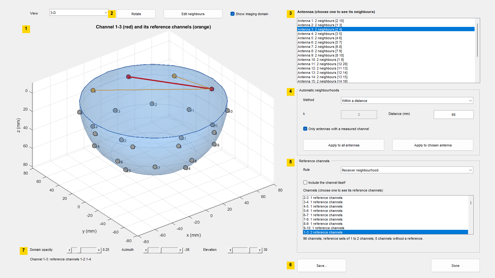

# neighbourhoodEditor

Show and edit antenna neighbourhoods and reference channels

Package: `artefact`

## Syntax

```matlab
artefact.neighbourhoodEditor(locations, channelPairs)
artefact.neighbourhoodEditor(___, Name, Value)
[fig, editor] = artefact.neighbourhoodEditor(___)
```

## Description

`artefact.neighbourhoodEditor(locations, channelPairs)` opens a figure showing the antennas in 3-D. Every antenna starts with the antennas within the default distance of [antennaNeighbours](antennaNeighbours.md) as neighbours, rounded to two significant digits in the display units; on the Galway array these are its two adjacent antennas. You can see and change each antenna's neighbourhood, form neighbourhoods automatically, and see the reference channels of each channel that follow from them (see [referenceChannels](referenceChannels.md)).

`artefact.neighbourhoodEditor(___, Name, Value)` sets options, for example initial neighbourhoods, the reference rule, display units, or waiting until Done is pressed.

`[fig, editor] = artefact.neighbourhoodEditor(___)` also returns the figure and a structure of functions that perform the same operations from a script and return the result.

## The window



1. **Antenna view.** The antennas in 3-D, labelled with their numbers. The chosen antenna is red and its neighbours blue; a chosen channel is drawn in red and its reference channels in orange. By default z increases downwards, so that the widest ring of the Galway array is at the top.
2. **View controls.** The View menu (3-D, top, front and side views), Rotate, and Edit neighbours.
3. **Antenna list.** Every antenna with the number of its neighbours and their numbers; choosing one shows its neighbourhood.
4. **Automatic neighbourhoods.** The method (within a distance or k nearest), its distance or k, the measured-channel restriction and the Apply buttons.
5. **Reference channels.** The rule, whether a channel is included in its own reference, the channel list with the size of each reference set, and a summary.
6. **Save... and Done.**

The line below the antenna view reports the last action.

## Using the window

1. **See a neighbourhood.** Choose an antenna in the antenna list or click it in the view. It turns red, its neighbours turn blue, and dashed lines join them.
2. **Change a neighbourhood by hand.** With an antenna chosen, press **Edit neighbours**. Each click on another antenna now adds it to or removes it from the chosen antenna's neighbourhood. Press Edit neighbours again to return to choosing antennas.
3. **Form neighbourhoods automatically.** In Automatic neighbourhoods, choose **Within a distance** or **k nearest antennas**, set the distance or k, and press **Apply to all antennas** or **Apply to chosen antenna**. With "Only antennas with a measured channel" ticked, only antennas that share a measured channel are considered.
4. **See a channel's reference.** In Reference channels, choose the rule (receiver or transmitter neighbourhood) and whether the channel itself is included, then choose a channel in the channel list. The channel is drawn in red and its reference channels in orange. The summary gives the smallest and largest reference set and the number of channels without a reference.
5. **Keep the result** with Save..., or press Done.

The View menu gives 3-D, top, front and side views; with Rotate on, clicks turn the 3-D view instead of choosing antennas.

## Examples

### Edit and keep the result

```matlab
dataRoot = fullfile(fileparts(fileparts(fileparts(which('merit.process.delay')))), 'data');
locations = dlmread(fullfile(dataRoot, 'antenna_locations.csv'));
pairs = dlmread(fullfile(dataRoot, 'channel_names.csv'));
[fig, editor] = artefact.neighbourhoodEditor(locations, pairs, 'DisplayCoordinateUnits', 'mm', 'Wait', true);
result = editor.GetResult();
result.References{10}            % reference channels of channel 10
```

With `'Wait', true` the call returns after Done is pressed or the figure is closed.

### From a script

```matlab
[fig, editor] = artefact.neighbourhoodEditor(locations, pairs, 'Visible', 'off');
editor.ApplyMethod('distance', 'Distance', 0.09);      % all antennas within 90 mm
editor.SetNeighbours(1, [2 3 10]);                     % antenna 1 by hand
editor.SetReferenceOptions('Rule', 'transmitter');
editor.Save('neighbourhoods.mat');
```

### Show a channel with its reference in the signal viewer

```matlab
scan1 = dlmread(fullfile(dataRoot, 'B0_P3_p000.csv'));
f = dlmread(fullfile(dataRoot, 'frequencies.csv'));
[~, viewer] = signalvis.signalViewer(scan1, f, pairs, 'References', editor.GetResult(), ...
    'AxisUnits', 'Hz', 'DisplayAxisUnits', 'GHz');
viewer.ShowReference(10);
```

## Input Arguments

### `locations` — antenna coordinates

N x 3 numeric array

Antenna x, y and z coordinates in `CoordinateUnits`, for example MERIT's `antenna_locations` in metres.

### `channelPairs` — Tx and Rx antenna of each channel

C x 2 array of antenna numbers

MERIT's `channel_names`.

## Name-Value Arguments

| Name | Value | Default | Description |
|---|---|---|---|
| `InitialNeighbours` | N x 1 cell array | from `Method` | Neighbourhoods at the start. |
| `Method` | `'distance'`, `'nearest'` | `'distance'` | Method for the initial neighbourhoods and initial choice in the Method menu. |
| `Distance` | nonnegative scalar | 1.2 times the largest distance from an antenna to its nearest candidate, rounded to two significant digits in `DisplayCoordinateUnits` | Distance for the initial neighbourhoods and initial value of the distance box, in `CoordinateUnits`. |
| `K` | nonnegative integer | `2` | Number of nearest antennas for the initial neighbourhoods with `'nearest'`, and initial value of the k box. |
| `MeasuredOnly` | `true`, `false` | `true` | Initial setting of "Only antennas with a measured channel". |
| `Rule` | `'receiver'`, `'transmitter'` | `'receiver'` | Reference rule. |
| `IncludeSelf` | `true`, `false` | `false` | Include each channel in its own reference set. |
| `AntennaLabels` | N numbers or N text labels | `'1'`, `'2'`, ... | Labels of the antennas. |
| `CoordinateUnits` | `'m'`, `'cm'`, `'mm'` | `'m'` | Units of `locations` and of distances passed to the `editor` functions. |
| `DisplayCoordinateUnits` | `'m'`, `'cm'`, `'mm'` | same as `CoordinateUnits` | Units of the axes and of distances typed into the figure. |
| `ZDirection` | `'down'`, `'up'` | `'down'` | Direction in which z increases in the antenna view. With `'down'`, an array whose widest ring has the smallest z, such as the Galway array, is drawn with that ring at the top. |
| `Title` | character vector | describes the current choice | Title of the antenna view. |
| `Visible` | `'on'`, `'off'` | `'on'` | Figure visibility. |
| `Wait` | `true`, `false` | `false` | Return only after Done is pressed or the figure is closed; requires a visible figure. |

## Output Arguments

### `fig` — figure

Figure handle.

### `editor` — functions that act on the figure

structure

The functions perform the operations of the controls and remain usable after the figure is closed. Distances are in `CoordinateUnits`.

| Field | Description |
|---|---|
| `GetResult()` | Current result (described below). |
| `GetNeighbours()` | N x 1 cell array of neighbourhoods. |
| `GetReferences()` | C x 1 cell array of reference channels. |
| `SetNeighbours(i, list)` | Replace the neighbourhood of antenna *i*. |
| `ChooseAntenna(i)` | Show antenna *i* and its neighbours. |
| `ChooseChannel(c)` | Show channel *c* and its reference channels. |
| `ClickAt(viewLine)` | Act as a click along a 2 x 3 view line in display units: choose the nearest antenna, or in edit mode add or remove it. |
| `SetEditMode(tf)` | Switch edit mode on or off. |
| `ApplyMethod(method, Name, Value, ...)` | Apply `'distance'` (`Distance`) or `'nearest'` (`K`), with `Antennas` to limit the antennas changed and `MeasuredOnly`. |
| `SetReferenceOptions(Name, Value, ...)` | Set `Rule` and `IncludeSelf`. |
| `Save(file)` | Save the result as the variable `neighbourhoods` in a MAT-file. |

The structure also contains the handles `Figure`, `Axes`, `Markers`, `Labels`, `AntennaList`, `ChannelList` and `Status`.

`GetResult` returns a structure with the fields `Neighbours`, `References`, `Rule`, `IncludeSelf`, `NoReference`, `Missing` (as in [referenceChannels](referenceChannels.md)), `ChannelPairs`, `Locations`, `CoordinateUnits` and `History` (a description of each operation applied, in order).

## Tips

- **Size of reference sets.** With two neighbours per antenna and the receiver rule, a channel between adjacent antennas has one reference channel, because the transmitter is one of the receiver's two neighbours. Larger neighbourhoods (for example k = 4) give larger reference sets; the summary shows the range.
- **Hand edits are not restricted** to antennas with a measured channel. A neighbour without a measured channel produces no reference channel; the summary and `GetResult().Missing` show where this happens.
- **Errors from controls** are reported in the status line and leave the neighbourhoods unchanged; the `editor` functions raise errors instead.

## See Also

[antennaNeighbours](antennaNeighbours.md) | [referenceChannels](referenceChannels.md) | [signalViewer](../signalvis/signalViewer.md) | [Antenna Neighbourhoods and Reference Channels](../examples/neighbourhoods.md)
