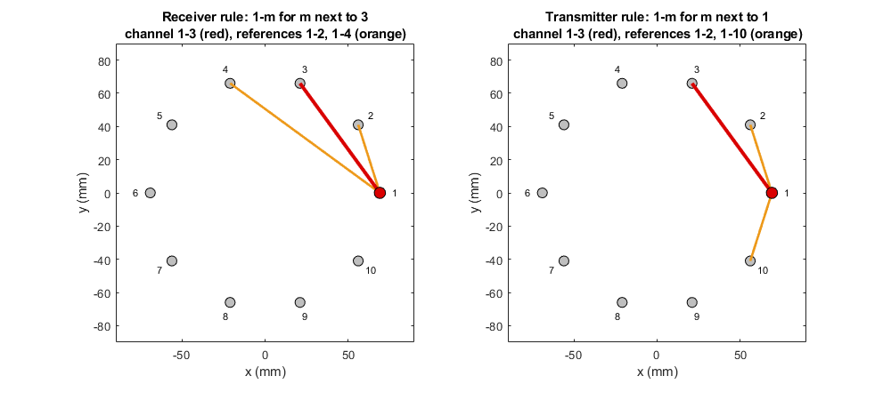

# referenceChannels

Reference channels of each channel from the antenna neighbourhoods

Package: `artefact`

## Syntax

```matlab
references = artefact.referenceChannels(neighbours, channelPairs)
references = artefact.referenceChannels(___, Name, Value)
[references, info] = artefact.referenceChannels(___)
```

## Description

`references = artefact.referenceChannels(neighbours, channelPairs)` gives, for every channel, the channels whose average is its reference in average subtraction of the early-time artefact. By default the receiver rule is used: the reference of channel *i*-*j* (antenna *i* transmits, *j* receives) is the channels from *i* to the neighbours of *j*. The channel itself is left out.

`references = artefact.referenceChannels(___, Name, Value)` chooses the transmitter rule instead, or includes the channel in its own reference.



With the default neighbourhoods of the Galway array, the neighbours of each antenna are its two adjacent antennas. Under the receiver rule (left), the reference of channel 1-3 keeps transmitter 1 and replaces receiver 3 by its neighbours 2 and 4. Under the transmitter rule (right), it consists of the channels from 1 to the neighbours of 1, antennas 2 and 10. Under neither rule is channel 1-3 itself, the signal received at 3, part of its reference.

`[references, info] = artefact.referenceChannels(___)` also reports channels without a reference and reference channels that would be needed but are not measured.

## Examples

### Both rules for channel 1-3 of the Galway array

```matlab
dataRoot = fullfile(fileparts(fileparts(fileparts(which('merit.process.delay')))), 'data');
locations = dlmread(fullfile(dataRoot, 'antenna_locations.csv'));
pairs = dlmread(fullfile(dataRoot, 'channel_names.csv'));
neighbours = artefact.antennaNeighbours(locations, pairs);
c = find(pairs(:,1) == 1 & pairs(:,2) == 3);

references = artefact.referenceChannels(neighbours, pairs);
pairs(references{c}, :)          % [1 2; 1 4]: from 1 to the neighbours 2 and 4 of receiver 3

references = artefact.referenceChannels(neighbours, pairs, 'Rule', 'transmitter');
pairs(references{c}, :)          % [1 2; 1 10]: from 1 to its own neighbours 2 and 10
```

### Reciprocity and a small reference set

```matlab
references = artefact.referenceChannels(neighbours, pairs);
c = find(pairs(:,1) == 9 & pairs(:,2) == 10);
pairs(references{c}, :)          % [1 9]
```

The neighbours of receiver 10 are 1 and 9. Antenna 9 is the transmitter and is skipped; channel 9-1 is not listed in the data, but its reciprocal 1-9 is, and serves in its place. With two neighbours per antenna, channels between adjacent antennas therefore have one reference channel; more neighbours give larger reference sets.

### Channels without a reference

```matlab
[references, info] = artefact.referenceChannels(neighbours, pairs);
info.NoReference                 % channels with an empty reference set
info.Missing{c}                  % [Tx Rx] pairs needed for channel c but not measured
```

## Input Arguments

### `neighbours` — neighbourhood of each antenna

N x 1 cell array

Element *i* lists the neighbours of antenna *i*, as returned by [antennaNeighbours](antennaNeighbours.md) or by the `GetNeighbours` function of [neighbourhoodEditor](neighbourhoodEditor.md). An antenna must not be its own neighbour.

### `channelPairs` — Tx and Rx antenna of each channel

C x 2 array of antenna numbers

MERIT's `channel_names`. Reference sets are given as row numbers of this array.

## Name-Value Arguments

| Name | Value | Default | Description |
|---|---|---|---|
| `Rule` | `'receiver'`, `'transmitter'` | `'receiver'` | For channel *i*-*j*: `'receiver'` uses the channels *i*-*m* for neighbours *m* of *j*; `'transmitter'` uses the channels *i*-*m* for neighbours *m* of *i*. |
| `IncludeSelf` | `true`, `false` | `false` | Include the channel in its own reference set. |

## Output Arguments

### `references` — reference channels of each channel

C x 1 cell array

Element *c* lists, in ascending order, the channels whose average is the reference for channel *c*.

### `info` — channels without a reference and missing channels

structure

| Field | Description |
|---|---|
| `NoReference` | Channels whose reference set is empty. |
| `Missing` | C x 1 cell array; element *c* lists, as rows `[Tx Rx]`, the channels needed for channel *c* that are not measured in either direction. |

## Algorithms

- **Reciprocity.** A measured channel *a*-*b* also serves as *b*-*a*. When both directions are measured, the channel in the requested direction is used.
- **Receiver rule.** Under the receiver rule, the transmitter itself is skipped when it is one of the receiver's neighbours, because channel *i*-*i* is not a reference for *i*-*j*.
- **Monostatic channels.** For a channel *i*-*i*, both rules give the channels *m*-*m* of the neighbours *m* of *i*.

## See Also

[antennaNeighbours](antennaNeighbours.md) | [neighbourhoodEditor](neighbourhoodEditor.md) | [signalViewer](../signalvis/signalViewer.md)
