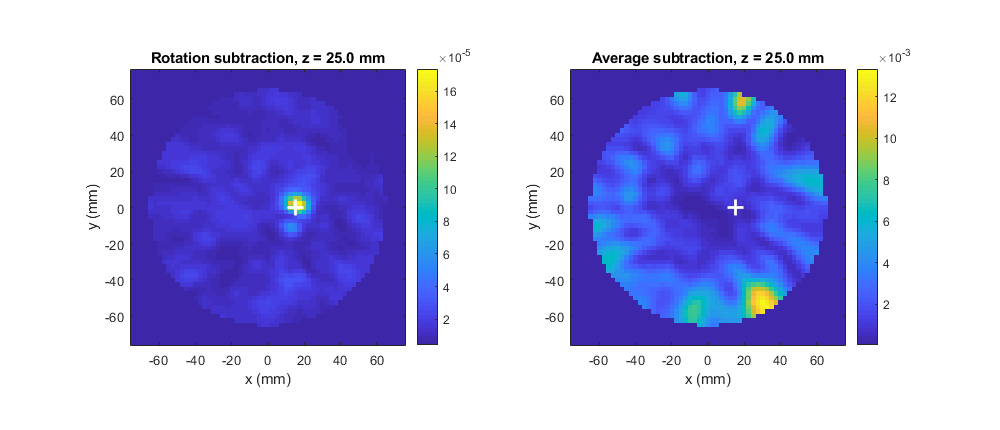

# Tutorial: From Measured Scans to an Image with Average Subtraction

This tutorial builds, step by step, a complete MATLAB script that takes a measured scan of a breast phantom to an image and evaluates the image. The signals are converted to the time domain before the early-time artefact is removed. The artefact is removed twice: first by rotation subtraction, which needs a second scan and serves as the reference result, and then by average subtraction, which needs only one scan. Each result is inspected in the signal viewer, imaged by delay-and-sum beamforming, displayed as a slice and evaluated with image metrics, and the two results are then compared.

Each section adds one block of code to the script, and the blocks together form the complete script.

## Before you start

- MERIT and MERIT-Extensions must be on the MATLAB path, as described in [Install MERIT-Extensions and Run a First Example](../installation.md). The function names below are those of the tested MERIT version; the [name table](../merit/README.md#names-in-earlier-versions) lists their names in MERIT 1.0.1.
- The script uses the Galway phantom data supplied with MERIT: phantom B0 with an 11 mm tumour at (15, 0, 35) mm, measured at two positions 36 degrees apart.
- The two beamforming steps take about half a minute each on a current desktop computer.

Create a new script, for example `myPipeline.m`, and add the blocks in order.

## 1. Load the data

```matlab
dataRoot = fullfile(fileparts(fileparts(fileparts(which('merit.process.delay')))), 'data');
frequencies = dlmread(fullfile(dataRoot, 'frequencies.csv'));
locations = dlmread(fullfile(dataRoot, 'antenna_locations.csv'));
pairs = dlmread(fullfile(dataRoot, 'channel_names.csv'));
scan = dlmread(fullfile(dataRoot, 'B0_P3_p000.csv'));
rotated = dlmread(fullfile(dataRoot, 'B0_P3_p036.csv'));
tumour = [15 0 35] * 1e-3;
```

`scan` and `rotated` are 76 x 96 arrays of complex scattering parameters: one row per frequency from 1.5 GHz to 4.5 GHz, one column per channel. Row c of `pairs` gives the transmitting and receiving antenna of column c. The antenna locations are in metres, so all lengths in the script are in metres. `tumour` holds the known tumour position, used later to judge the images.

## 2. Convert the signals to the time domain

```matlab
df = frequencies(2) - frequencies(1);      % 40 MHz: time span must stay below 1/df = 25 ns
dtMax = 1 / (2 * max(frequencies));        % 111 ps: Nyquist limit
dt = 1e-11;                                % chosen well below dtMax for accurate delays
timeAxis = 0:dt:6e-9;
tdScan = merit.process.fd2td(scan, frequencies, timeAxis);
tdRotated = merit.process.fd2td(rotated, frequencies, timeAxis);
```

[merit.process.fd2td](../merit-2019/process/fd2td.md) evaluates the real time-domain signal of each channel at the times in `timeAxis`, here every 10 ps from 0 to 6 ns. `tdScan` and `tdRotated` are 601 x 96 arrays. From here on, all processing uses the time-domain signals.

The early-time artefact, the reflection from the skin and the coupling between the antennas, dominates the first nanoseconds of every channel. The response of the tumour is much weaker and arrives later.

## 3. View the signals

```matlab
[~, viewer] = signalvis.signalViewer({tdScan, tdRotated}, timeAxis, pairs, ...
    'DatasetNames', {'Scan', 'Rotated scan'}, 'AxisUnits', 's', 'DisplayAxisUnits', 'ns', ...
    'InitialTx', 1, 'InitialRx', [2 3 4]);
```

The [signal viewer](../signalvis/signalViewer.md) shows channels 1-2, 1-3 and 1-4 of both scans against time in nanoseconds. Tick other Tx and Rx antennas, or single channels, to see other channels. The two scans almost coincide, because the artefact, which changes little when the phantom is rotated, dominates both.

## 4. Remove the artefact by rotation subtraction

```matlab
rotationSubtracted = tdScan - tdRotated;
[~, rotationViewer] = signalvis.signalViewer({tdScan, rotationSubtracted}, timeAxis, pairs, ...
    'DatasetNames', {'Scan', 'Rotation-subtracted'}, 'AxisUnits', 's', 'DisplayAxisUnits', 'ns', ...
    'InitialTx', 1, 'InitialRx', [2 3 4]);
```

Rotating the phantom moves the tumour relative to the antennas but leaves the artefact nearly unchanged, so the difference of the two scans retains mainly the tumour response. In the second viewer, the rotation-subtracted signals are about ten times smaller than the scan: the artefact has been removed. This result needs two scans and serves as the reference for average subtraction below.

## 5. Prepare the imaging

```matlab
[points, axes_] = merit.domain.hemisphere('radius', 7e-2, 'resolution', 2.5e-3);
delays = merit.beamform.get_delays(pairs, locations, 'relative_permittivity', 8);
allDelays = delays(points);
windowLength = numel(timeAxis) - ceil(max(-allDelays(:)) / dt);
window = merit.beamform.windows.rectangular(windowLength);
```

- `points` lists the 47185 grid points, 2.5 mm apart, inside a hemisphere of 7 cm radius, and `axes_` holds the grid axes ([merit.domain.hemisphere](../merit-2019/domain/hemisphere.md)).
- `delays` is a function that gives, for every channel and point, the round-trip travel time in a medium of relative permittivity 8 ([merit.beamform.get_delays](../merit-2019/beamform/get_delays.md)).
- In the time domain, [merit.process.delay](../merit-2019/process/delay.md) shifts each signal by whole samples and fills the vacated samples with `NaN`. The largest delay is 2.6 ns, or 260 samples, so only the first 340 of the 601 samples are valid for every point. The rectangular window keeps exactly these samples; without it, every image value would be `NaN` ([merit.beamform.windows.rectangular](../merit-2019/beamform/windows/rectangular.md)).

## 6. Image the rotation-subtracted signals

```matlab
imageRotation = merit.beamform(rotationSubtracted, timeAxis, points, delays, ...
    merit.beamformers.DAS, 'window', window);
[~, peak] = max(imageRotation);
peakRotation = points(peak, :);
sliceRotation = merit.visualize.get_slice(imageRotation, points, axes_, 'z', peakRotation(3));
figure('Name', 'Rotation subtraction');
imagesc(axes_{1} * 1e3, axes_{2} * 1e3, sliceRotation.');
axis xy equal tight; colorbar;
hold on; plot(tumour(1) * 1e3, tumour(2) * 1e3, 'w+', 'MarkerSize', 12, 'LineWidth', 2);
xlabel('x (mm)'); ylabel('y (mm)');
title(sprintf('Rotation subtraction, z = %.1f mm', peakRotation(3) * 1e3));
```

[merit.beamform](../merit-2019/beamform.md) delays every channel for each point and combines the delayed signals with delay-and-sum ([merit.beamformers.DAS](../merit-2019/beamformers/DAS.md)); for real time-domain signals the image values are real. The figure shows the plane through the maximum of the image, with the true tumour position marked by a white cross. [merit.visualize.get_slice](../merit-2019/visualize/get_slice.md) returns the plane with x along the rows, so it is transposed for display with x horizontal.

## 7. Evaluate the rotation-subtracted image

```matlab
errorRotation = norm(peakRotation - tumour) * 1e3
[wx, wy, wz] = merit.metrics.FWHM(imageRotation, points, axes_{:});
fwhmRotation = [wx wy wz] * 1e3
scrRotation = merit.metrics.SCR(imageRotation, points, axes_{:})
smrRotation = merit.metrics.SMR(imageRotation, points, axes_{:})
```

| Measure | Meaning | Rotation subtraction |
|---|---|---|
| `errorRotation` | Distance from the image maximum to the tumour | 10.3 mm: the maximum is at (15, 2.5, 25) mm |
| `fwhmRotation` | Width of the main response along x, y and z ([FWHM](../merit-2019/metrics/FWHM.md)) | 10, 7.5 and 20 mm |
| `scrRotation` | Maximum of the main response over the largest value elsewhere, in dB ([SCR](../merit-2019/metrics/SCR.md)) | 2.75 dB |
| `smrRotation` | Maximum of the main response over the mean of the image, in dB ([SMR](../merit-2019/metrics/SMR.md)) | 10.9 dB |

The maximum lies 10 mm above the tumour along z, which is the direction in which the ring array resolves least, and the main response stands out from the rest of the image. Pass the grid axes to the metrics; without them the widths are counted in grid steps.

## 8. Define the neighbourhoods and reference channels

```matlab
neighbours = artefact.antennaNeighbours(locations, pairs);
references = artefact.referenceChannels(neighbours, pairs);
c = find(pairs(:, 1) == 1 & pairs(:, 2) == 3);
pairs(references{c}, :)
```

Average subtraction needs only the one scan. It assumes that channels between nearby antennas share the same artefact, and it subtracts from every channel the average of such channels:

- [antennaNeighbours](../artefact/antennaNeighbours.md) gives every antenna the antennas within the default distance, here its two adjacent antennas in the same ring.
- [referenceChannels](../artefact/referenceChannels.md) gives every channel its reference channels by the receiver rule: for channel 1-3, the channels from antenna 1 to the neighbours 2 and 4 of antenna 3, which the last line prints as `[1 2; 1 4]`.

## 9. View and edit the neighbourhoods

```matlab
[~, editor] = artefact.neighbourhoodEditor(locations, pairs, 'InitialNeighbours', neighbours, ...
    'ImagingDomain', points, 'DisplayCoordinateUnits', 'mm');
```

The [neighbourhood editor](../artefact/neighbourhoodEditor.md) shows the antennas around the imaging domain, with the neighbourhoods of step 8:

- **See a neighbourhood.** Choose an antenna in the antenna list or click it: it turns red, and its neighbours turn blue, joined to it by lines.
- **Change it by hand.** Press **Edit neighbours** and click other antennas to add them to or remove them from the chosen antenna's neighbourhood.
- **Form all neighbourhoods anew.** Under Automatic neighbourhoods, choose a distance or k nearest antennas and press **Apply to all antennas**.
- **See the effect on the references.** Choose a channel in the channel list: it is drawn in red and its reference channels in orange.

The script does not wait for the editor, so the steps below use the neighbourhoods of step 8. To use edited neighbourhoods instead, replace the line above with a call that waits until **Done** is pressed, and take the reference channels from the editor:

```text
[~, editor] = artefact.neighbourhoodEditor(locations, pairs, 'InitialNeighbours', neighbours, ...
    'ImagingDomain', points, 'DisplayCoordinateUnits', 'mm', 'Wait', true);
references = editor.GetResult();
```

[subtractAverage](../artefact/subtractAverage.md) and the signal viewer accept this result in place of the reference channels from `referenceChannels`.

## 10. Remove the artefact by average subtraction

```matlab
averageSubtracted = artefact.subtractAverage(tdScan, references);
[~, averageViewer] = signalvis.signalViewer({tdScan, averageSubtracted, rotationSubtracted}, timeAxis, pairs, ...
    'DatasetNames', {'Scan', 'Average-subtracted', 'Rotation-subtracted'}, 'References', references, ...
    'AxisUnits', 's', 'DisplayAxisUnits', 'ns');
averageViewer.ShowReference(c);
```

[subtractAverage](../artefact/subtractAverage.md) subtracts from every channel the average of its reference channels. The viewer shows channel 1-3, drawn thick, with its reference channels 1-2 and 1-4, in the scan and after both kinds of subtraction.

## 11. Image and evaluate the average-subtracted signals

```matlab
imageAverage = merit.beamform(averageSubtracted, timeAxis, points, delays, ...
    merit.beamformers.DAS, 'window', window);
[~, peak] = max(imageAverage);
peakAverage = points(peak, :);
sliceAverage = merit.visualize.get_slice(imageAverage, points, axes_, 'z', peakRotation(3));
figure('Name', 'Average subtraction');
imagesc(axes_{1} * 1e3, axes_{2} * 1e3, sliceAverage.');
axis xy equal tight; colorbar;
hold on; plot(tumour(1) * 1e3, tumour(2) * 1e3, 'w+', 'MarkerSize', 12, 'LineWidth', 2);
xlabel('x (mm)'); ylabel('y (mm)');
title(sprintf('Average subtraction, z = %.1f mm', peakRotation(3) * 1e3));

errorAverage = norm(peakAverage - tumour) * 1e3
[wx, wy, wz] = merit.metrics.FWHM(imageAverage, points, axes_{:});
fwhmAverage = [wx wy wz] * 1e3
scrAverage = merit.metrics.SCR(imageAverage, points, axes_{:})
smrAverage = merit.metrics.SMR(imageAverage, points, axes_{:})
```

The slice is taken in the same plane as the rotation-subtracted slice, so that the two figures can be compared directly.

## 12. Compare the two results

```matlab
similarity = corrcoef(imageAverage, imageRotation);
similarity = similarity(1, 2)
comparison = table([errorRotation; errorAverage], [scrRotation; scrAverage], [smrRotation; smrAverage], ...
    'VariableNames', {'PeakErrorMM', 'SCRdB', 'SMRdB'}, 'RowNames', {'Rotation', 'Average'})
```

`similarity` is the correlation coefficient between the two images over all points: 1 for identical images up to a scale factor, 0 for unrelated ones.



| Measure | Rotation subtraction | Average subtraction |
|---|---|---|
| Image maximum | (15, 2.5, 25) mm | (30, −52.5, 25) mm |
| Distance to the tumour | 10.3 mm | 55.5 mm |
| FWHM along x, y and z | 10, 7.5 and 20 mm | 17.5, 17.5 and 30 mm |
| SCR | 2.75 dB | 0.71 dB |
| SMR | 10.9 dB | 7.85 dB |
| Correlation with the rotation-subtracted image | 1 | −0.12 |

With the default neighbourhoods, average subtraction does not reproduce the rotation-subtracted image on these data. The maximum lies near the antennas, far from the tumour, and the image is unrelated to the reference. The signal viewer of step 10 shows the reason: the average-subtracted signals are not smaller than the scan. The reference channels 1-2 and 1-4 of channel 1-3 connect antennas at different separations from those of 1-3, so their artefacts differ in delay and shape, and subtracting their average adds as much as it removes.

Average subtraction can be improved by choosing reference channels whose artefact matches better. Try other neighbourhoods, for example `artefact.antennaNeighbours(locations, pairs, 'Distance', 0.09)`, the transmitter rule (`'Rule', 'transmitter'` in `referenceChannels`), or neighbourhoods edited by hand in the neighbourhood editor of step 9, and compare each result with the rotation-subtracted image by rerunning steps 8 to 12.

## Run the complete script

With all twelve blocks added in order, save the script and run it, for example with `run('myPipeline.m')`. It opens three signal viewers, the neighbourhood editor and two image figures, and prints the metrics and the comparison table. To try another neighbourhood or reference rule, change step 8, or edit the neighbourhoods as described in step 9, and run the script again.

## See Also

[Getting Started](../getting-started.md) | [Compare Original, Rotated and Rotation-Subtracted Scans](../examples/compare-scans.md) | [Antenna Neighbourhoods and Reference Channels](../examples/neighbourhoods.md) | [subtractAverage](../artefact/subtractAverage.md) | [Getting Started with MERIT (2019 snapshot)](../merit-2019/getting-started.md)
